# Cohesion Foundation: Email and File Storage Guide

Your account gives you two things, with **one password for both**:

| | What | Where |
|---|---|---|
| **Email** | `yourname@cohesion-foundation.org` | Outlook on your computer, or your phone's mail app |
| **Files** | Store, sync and share documents | **https://drive.cohesion-foundation.org** (web, desktop app, phone app) |

Your admin gives you two things privately: your **username** (the part of your email before the `@`, for example
`ekaryadi`) and your **initial password**.

| Signing in to | Username | Password |
|---|---|---|
| Files (OpenCloud) | short username, e.g. `ekaryadi` | your password |
| Email (Outlook, phone) | full address, e.g. `ekaryadi@cohesion-foundation.org` | the same password |

**First thing to do:** sign in to the files site and change your password (section 1.6). The new password works for email too.

---

## 1. Files (OpenCloud)

### 1.1 Sign in

Open **https://drive.cohesion-foundation.org** and enter your **short username** (not your email address) and password.

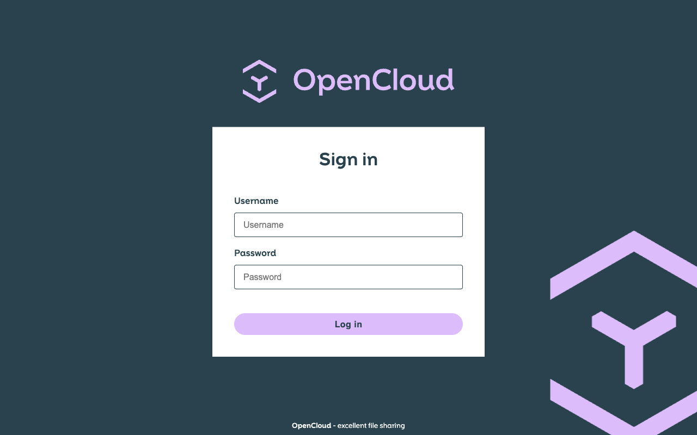

### 1.2 Your files

**Personal** holds your own files. On the left:

| Item | What it is |
|---|---|
| **Personal** | your own files |
| **Favorites** | files you starred |
| **Shares** | files others shared with you, and files you shared |
| **Spaces** | shared team folders |
| **Deleted files** | deleted files, which you can restore from here |

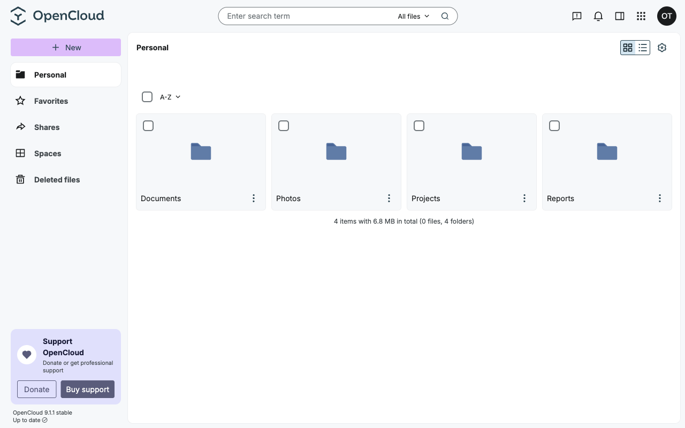

### 1.3 Upload and create

Click **+ New**:

- **Files Upload** / **Folder Upload**: upload from your computer or phone
- **Folder**: create a new folder

You can also drag files from your computer straight into the browser window.

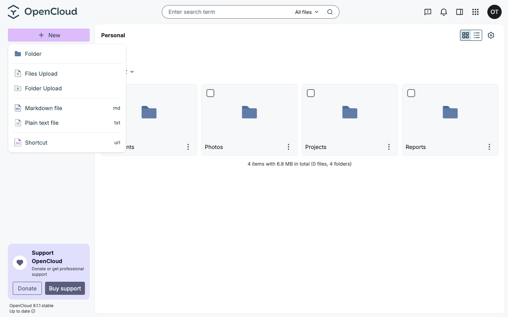

### 1.4 Download, rename, move, delete

Click **⋮** next to a file or folder for **Download**, **Rename**, **Copy to**, **Move to**, **Delete** and **Share**.

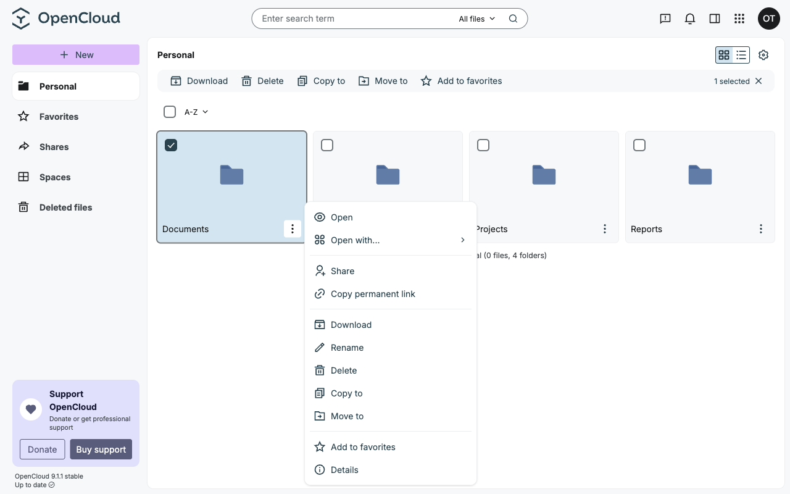

### 1.5 Share

Choose **Share** in the **⋮** menu. A panel opens on the right:

- **Share with people:** type a colleague's name, choose their permission (*Can view* or *Can edit*), and click **Share**.
  The file appears under **Shares** for them.
- **Public links → Add link:** anyone who has the link can open it, **including people outside the foundation**.
  Use this only for files that may be seen by outsiders, set a password or expiry date where possible, and delete the link when it is no longer needed.

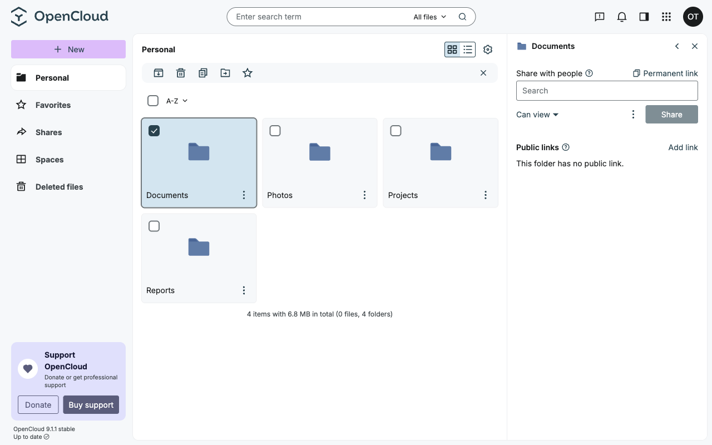

### 1.6 Change your password

1. Click your initials (top right) → **Preferences**.

   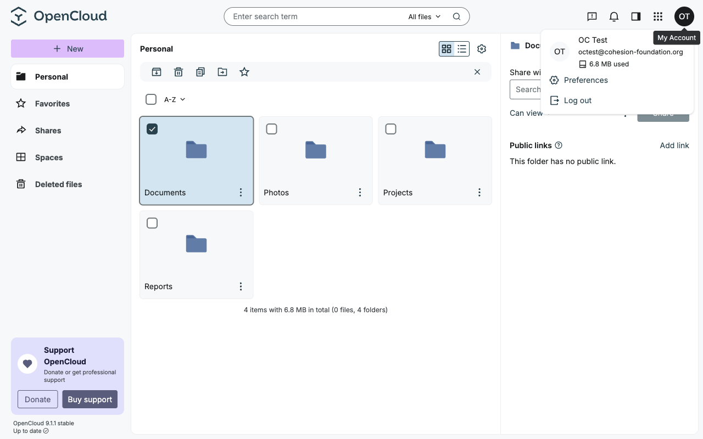

2. Next to **Password**, click **Change password**.

   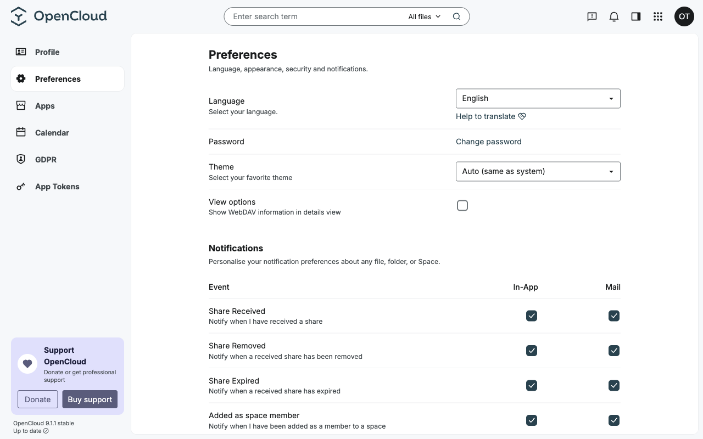

3. Enter your current password, then the new one twice, and click **Confirm**.

   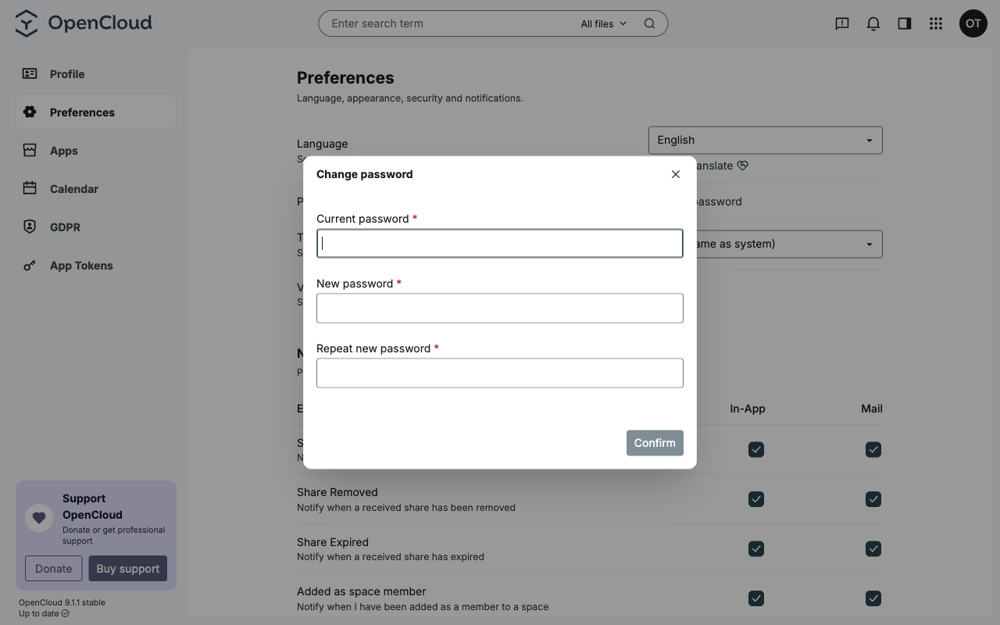

Your **email password changes too**. Within about 10 minutes, Outlook or your phone asks for the new password; enter it there.

Use a long password (at least 12 characters) that you don't use anywhere else. Anyone with it can read both your files and your email.

### 1.7 Desktop app (synced folder on your computer)

1. Install **OpenCloud Desktop**:
   - **Windows:** from the Microsoft Store (search "OpenCloud").
   - **Mac:** download the `.pkg` from https://github.com/opencloud-eu/desktop/releases.
2. Server address: `https://drive.cohesion-foundation.org`.
3. Sign in in the browser window that opens (short username + password), then choose a folder on your computer to sync.

Files in that folder sync to the server automatically, and the other way round.

### 1.8 Phone app

Install **OpenCloud** from the App Store or Google Play. Server: `https://drive.cohesion-foundation.org`, then sign in.
You can view files and upload photos and documents from your phone.

### 1.9 Network drive (optional)

To open your files directly from File Explorer or Finder without the app:

- **Windows:** File Explorer → *This PC* → **Map network drive** → `https://drive.cohesion-foundation.org/remote.php/webdav/`
- **Mac:** Finder → **Go → Connect to Server** → `https://drive.cohesion-foundation.org/remote.php/webdav/`

Sign in with your short username and password.

---

## 2. Email

### 2.1 Settings (all mail apps)

| | Server | Port | Security | Username | Password |
|---|---|---|---|---|---|
| **Incoming (IMAP)** | `mail.cohesion-foundation.org` | **993** | SSL/TLS | your full email address | your password |
| **Outgoing (SMTP)** | `mail.cohesion-foundation.org` | **587** | STARTTLS | your full email address | your password |

Your existing mail and folders (Inbox, Sent, Drafts) are on the server and appear automatically.

**Use one of these apps:**

| Device | App |
|---|---|
| Windows | **Classic Outlook** (Microsoft 365 / Office), or Thunderbird (free) |
| Mac | **Outlook for Mac** (choose *Sync directly with IMAP*, see below), or Apple Mail |
| iPhone / iPad | the built-in **Mail** app |
| Android | **Thunderbird** |

**Do not use** the *new Outlook for Windows* or the *Outlook app on iPhone/Android*. They send your password and your
mail through Microsoft's servers. Classic Outlook has a **File** tab at the top left; the new Outlook doesn't.

### 2.2 Outlook for Mac

1. Outlook → **Settings → Accounts → +** (or **Add Account** on first start). Enter your email address and click **Continue**.

   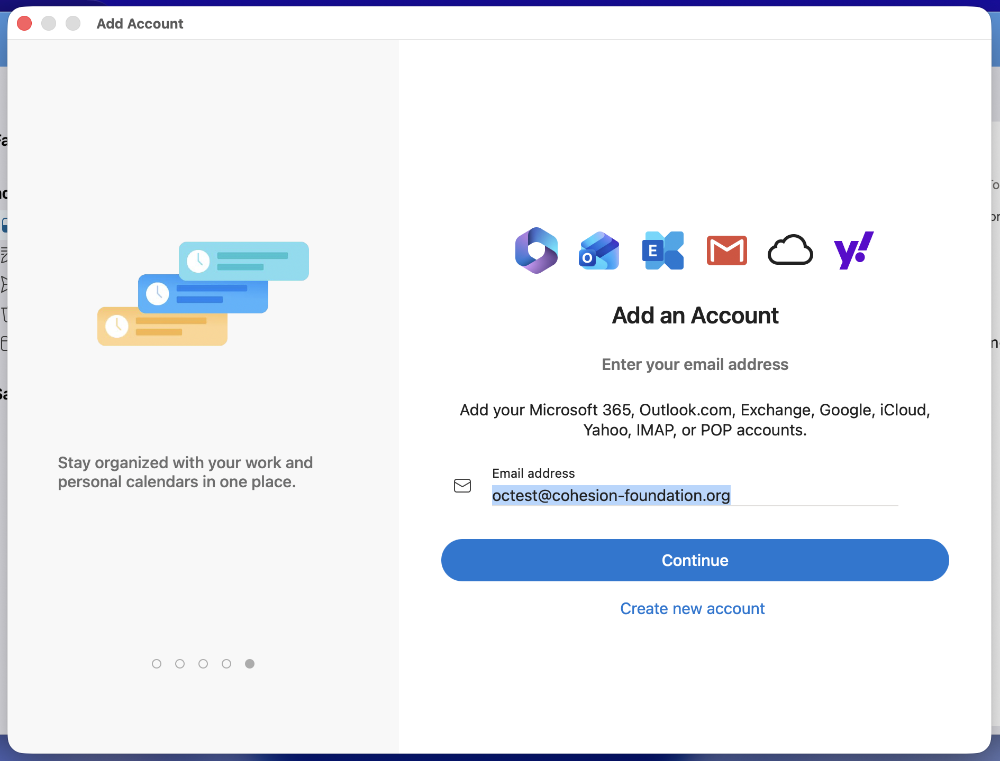

2. Outlook offers to sync through the Microsoft Cloud. **Do not click *Sign in*.** Click **Sync directly with IMAP**.

   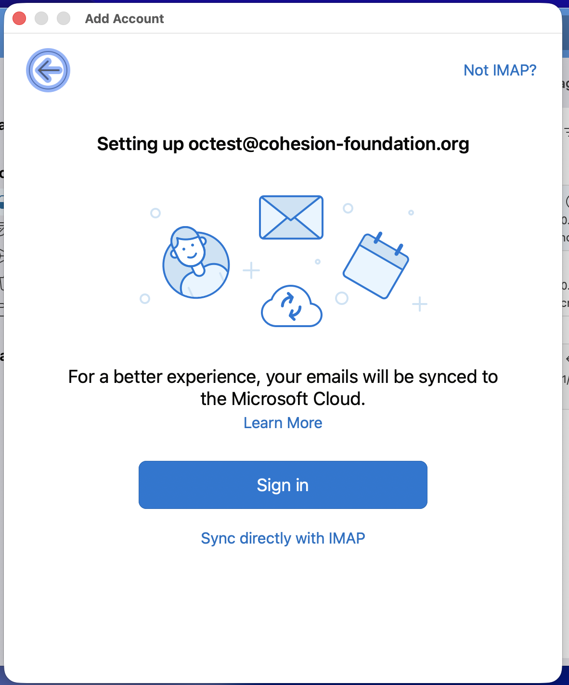

3. Enter the settings from 2.1:
   - Email address and username: your full address
   - IMAP Password: your password
   - Incoming server `mail.cohesion-foundation.org`, port **993**, *Use SSL to connect*
   - Outgoing server `mail.cohesion-foundation.org`, port **587**, *StartTLS*
   - Leave **SMTP Username** and **SMTP Password** empty: Outlook reuses the ones above.

   Click **Add Account**.

   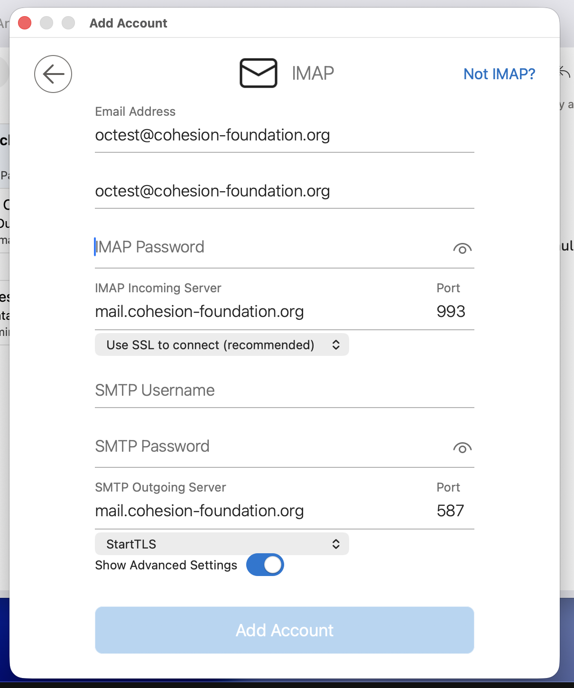

4. The account is added. Choose a profile or click **Skip for now**.

   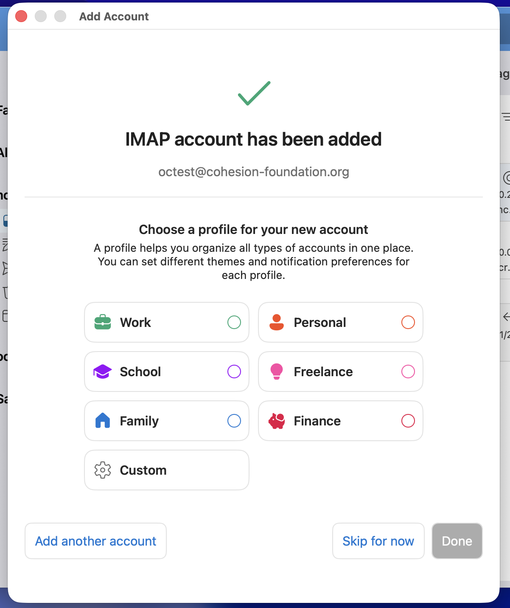

5. Your folders appear in the left column.

   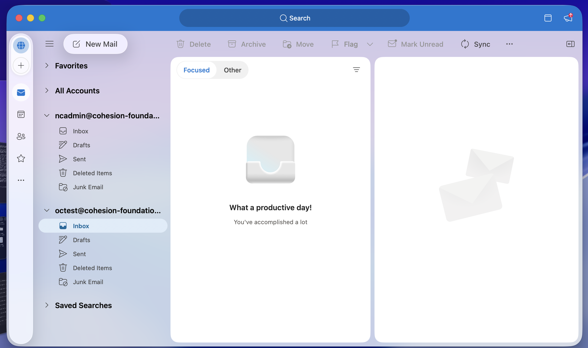

Outlook sorts incoming mail into **Focused** and **Other**. If you can't find a message, check **Other**.

### 2.3 Classic Outlook for Windows

1. **File → Add Account**, then enter your email address.
2. Click **Advanced options**, tick **Let me set up my account manually**, click **Connect**, then choose **IMAP**.
3. Enter the settings from 2.1, then your password, and click **Connect**.

### 2.4 iPhone / iPad

**Settings → Apps → Mail → Mail Accounts → Add Account → Other → Add Mail Account.** Enter your name, email and
password, choose **IMAP**, and fill in both servers from 2.1. The username is your full email address.

### 2.5 Android

Install **Thunderbird** from Google Play, add an account with your email and password, and choose **manual configuration**
if the settings aren't found automatically. Use the values from 2.1.

### 2.6 Your name and signature

The name recipients see and your signature are set **in your mail app**:

- **Outlook for Mac:** Settings → Accounts → your account → *Full Name*; signatures under Settings → Signatures.
- **Classic Outlook:** File → Account Settings → your account → *Your Name*; File → Options → Mail → Signatures.

### 2.7 Good to know

- **Large files:** attachments can be up to about 18 MB in total. For bigger files, upload them to OpenCloud and share a link (section 1.5).
- **Junk mail** goes to the *Junk Email* folder. Check it if you're missing a message.
- **Webmail:** there is no email in the browser. Use Outlook or your phone.

---

## 3. Security

- Never share your password, not even with the admin. **The admin will never ask for it** by email or chat.
- Be careful with emails asking you to "verify your account" or log in through a link. Check with the admin first.
- On a shared or public computer, sign out of OpenCloud (initials → **Log out**) when you're done.
- If you think someone knows your password, change it immediately (section 1.6) and tell the admin.

## 4. Help

Contact the admin. Mention your username and, if possible, send a screenshot of the error message
(**never** a screenshot showing your password).
