# Panduan Email dan Penyimpanan Berkas Yayasan

Alamat: **https://cloud.cohesion-foundation.org**

Di sini Anda bisa:

- **Email** — membaca dan mengirim email dengan alamat `nama@cohesion-foundation.org`.
- **Berkas** — menyimpan, mengunggah, dan membagikan dokumen yayasan.

Yang Anda perlukan hanya browser (Chrome, Firefox, Safari, atau Edge) di komputer atau HP.
Email hanya dibuka lewat alamat di atas; aplikasi email lain (Gmail, Outlook) tidak bisa dipakai.

---

## 1. Masuk

1. Buka **https://cloud.cohesion-foundation.org**.
2. **Nama akun**: bagian alamat email Anda sebelum tanda `@`.
   Contoh: email `ekaryadi@cohesion-foundation.org` → nama akun `ekaryadi`.
3. **Kata Sandi**: kata sandi yang diberikan oleh admin yayasan.
4. Klik **Masuk**.

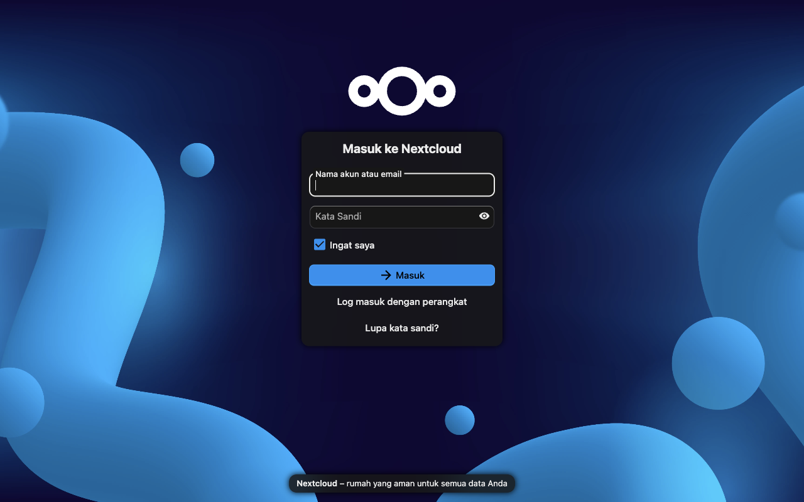

Centang **Ingat saya** hanya di komputer atau HP pribadi Anda.

---

## 2. Ganti kata sandi (wajib saat pertama kali masuk)

1. Klik **lingkaran inisial nama Anda** di pojok kanan atas, lalu pilih **Setelan**.

   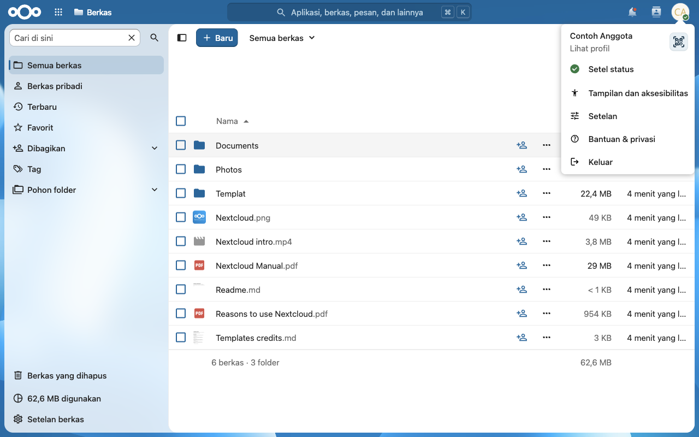

2. Di menu kiri, pilih **Keamanan**.
3. Isi **Kata sandi saat ini** (dari admin) dan **Kata sandi baru**, lalu klik **Ubah sandi**.

   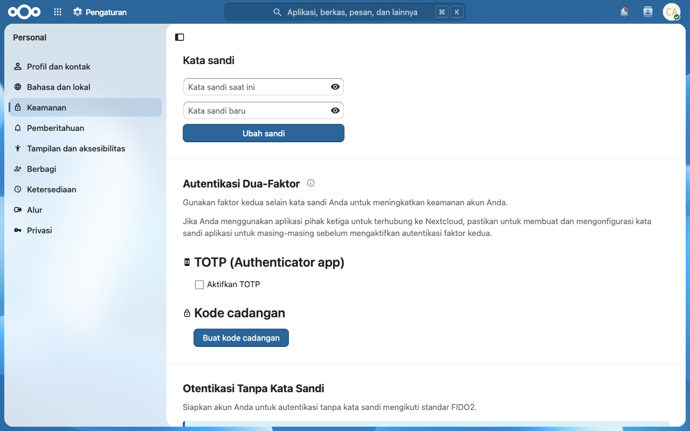

Gunakan kata sandi yang panjang (minimal 12 karakter) dan tidak dipakai di tempat lain.

**Lupa kata sandi?** Hubungi admin yayasan untuk dibuatkan kata sandi baru.
Tautan "Lupa kata sandi?" mengirim email ke kotak masuk yayasan Anda, yang tidak bisa dibuka sebelum Anda masuk.

---

## 3. Atur nama Anda

1. Klik lingkaran inisial → **Setelan** → **Profil dan kontak**.
2. Isi **Nama lengkap** dengan nama Anda. Perubahan tersimpan otomatis.

Nama ini juga menjadi **nama pengirim email** Anda. Email berikutnya memakai nama baru paling lambat 5 menit kemudian.

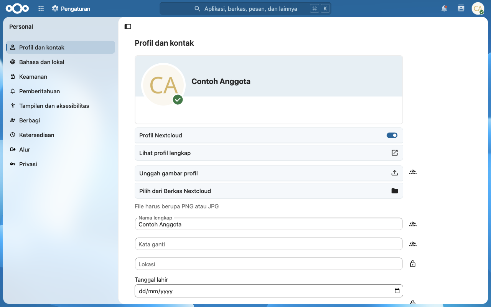

---

## 4. Email

Setelah masuk, halaman **Email** langsung terbuka.
Untuk berpindah antara **Email** dan **Berkas**, klik ikon **kotak-kotak (⠿)** di kiri atas, di sebelah logo.

### Kotak masuk

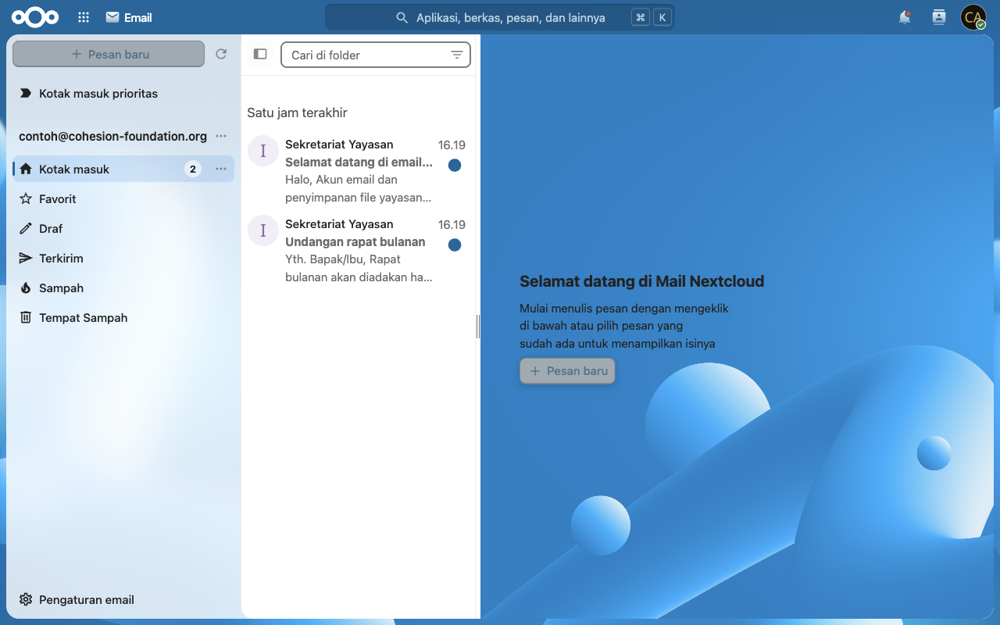

Folder di sebelah kiri:

| Folder | Isi |
|---|---|
| **Kotak masuk** | Email yang masuk |
| **Favorit** | Email yang Anda beri bintang |
| **Draf** | Email yang belum selesai ditulis (tersimpan otomatis) |
| **Terkirim** | Email yang sudah Anda kirim |
| **Sampah** (ikon api) | Email yang dianggap spam |
| **Tempat Sampah** (ikon tong) | Email yang Anda hapus |

### Membaca dan membalas

Klik email di daftar untuk membukanya. Klik **Balas** untuk membalas.

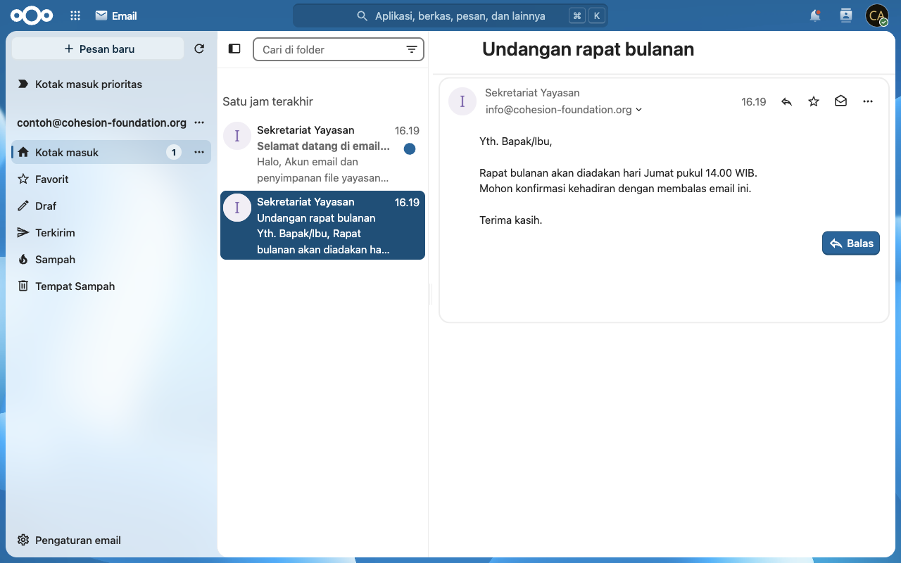

Ikon di kanan atas email: balas, beri bintang (favorit), tandai belum dibaca, dan **⋯** untuk pilihan lain (teruskan, hapus, pindahkan).

### Menulis email baru

1. Klik **+ Pesan baru** di kiri atas.
2. **Kepada**: ketik alamat email penerima, lalu tekan Enter.
   Klik **Cc/Bcc** jika perlu tembusan.
3. **Subjek**: judul email.
4. Tulis isi pesan.
5. Untuk melampirkan berkas, klik ikon **klip kertas** di bawah. Ukuran maksimal semua lampiran sekitar 18 MB;
   untuk berkas lebih besar, bagikan tautan dari **Berkas** (lihat bagian 5).
6. Klik **Kirim**.

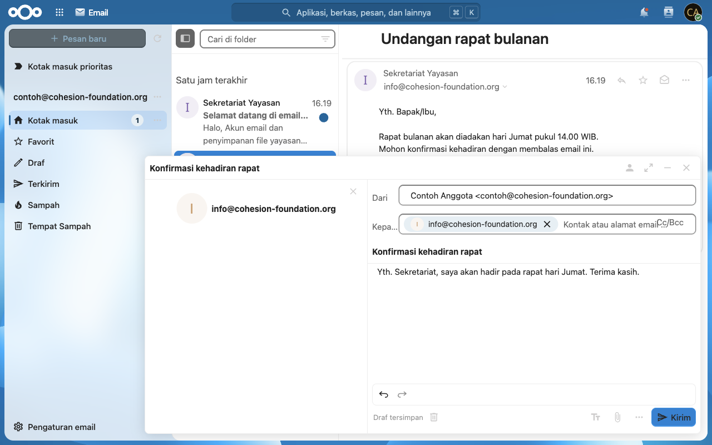

### Nama pengirim dan tanda tangan

**Nama pengirim** (nama yang dilihat penerima) mengikuti **Nama lengkap** di profil Anda (lihat bagian 3).
Untuk mengubahnya, ubah Nama lengkap di profil. Jangan klik ikon pensil di bagian **Alias**:
ikon itu membuka pengaturan server email (lihat peringatan di bawah).

**Tanda tangan** bisa Anda atur sendiri:

1. Klik **⋯** di samping alamat email Anda (kiri atas), lalu **Pengaturan akun**.
2. Pilih **Tanda tangan**, tulis tanda tangan email (misalnya nama, jabatan, nomor telepon), lalu simpan.

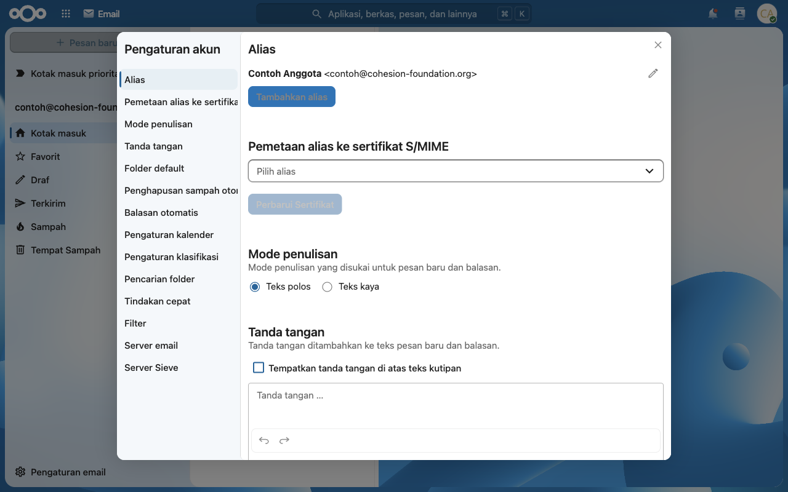

**Jangan mengubah bagian "Server email".** Pengaturan itu sudah disiapkan oleh admin; jika diubah, email Anda berhenti berfungsi.

---

## 5. Berkas (penyimpanan dokumen)

Klik ikon **kotak-kotak (⠿)** di kiri atas, lalu pilih **Berkas**.

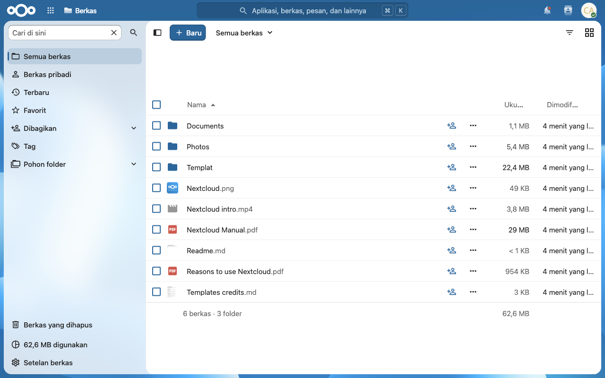

Saat pertama kali, ada beberapa contoh berkas dari Nextcloud. Anda boleh menghapusnya.

### Mengunggah dan membuat folder

Klik **+ Baru**:

- **Unggah berkas** — pilih berkas dari komputer/HP.
- **Upload folders** — unggah satu folder sekaligus.
- **Folder baru** — membuat folder.

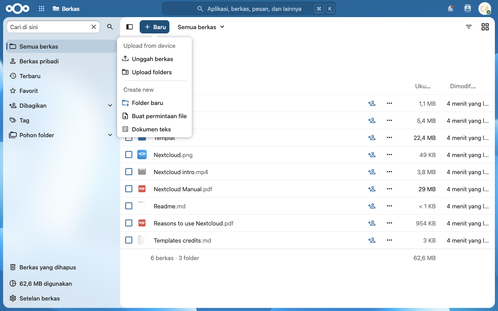

Di komputer, Anda juga bisa **menyeret berkas** dari komputer langsung ke daftar berkas.

### Mengunduh, mengganti nama, menghapus

Klik **⋯** di baris berkas untuk **Unduh**, **Ganti nama**, **Pindahkan atau salin**, dan **Hapus**.
Berkas yang dihapus masuk ke **Berkas yang dihapus** (kiri bawah) dan masih bisa dikembalikan selama beberapa waktu.

### Membagikan berkas atau folder

Klik ikon **orang dengan tanda +** di baris berkas. Panel **Berbagi** terbuka di kanan.

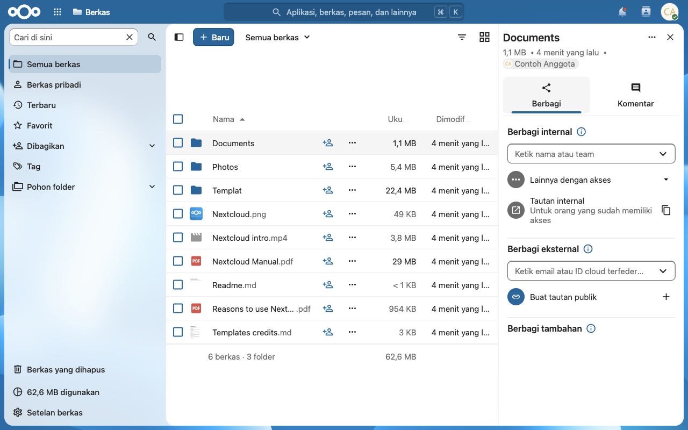

- **Berbagi internal**: ketik nama anggota yayasan, lalu pilih orangnya. Berkas muncul di **Berkas** mereka.
- **Buat tautan publik**: siapa pun yang memegang tautan bisa membuka berkas, termasuk orang di luar yayasan.
  Gunakan hanya untuk berkas yang memang boleh dilihat orang luar, dan hapus tautannya jika sudah tidak diperlukan.

Berkas yang dibagikan kepada Anda ada di menu **Dibagikan** di kiri.

---

## 6. Menggunakan HP

- **Email dan Berkas**: buka **https://cloud.cohesion-foundation.org** di browser HP, lalu masuk seperti biasa.
- **Berkas saja** (opsional): pasang aplikasi **Nextcloud** dari Play Store / App Store, lalu masukkan alamat server
  `https://cloud.cohesion-foundation.org`. Aplikasi ini hanya untuk berkas, bukan email.

---

## 7. Keluar

Klik lingkaran inisial di kanan atas → **Keluar**.
Selalu keluar jika memakai komputer bersama atau milik orang lain.

---

## Butuh bantuan?

Hubungi admin yayasan. Sebutkan nama akun Anda dan, jika ada, kirimkan tangkapan layar pesan kesalahannya.
**Jangan pernah memberitahukan kata sandi Anda kepada siapa pun**, termasuk admin.
